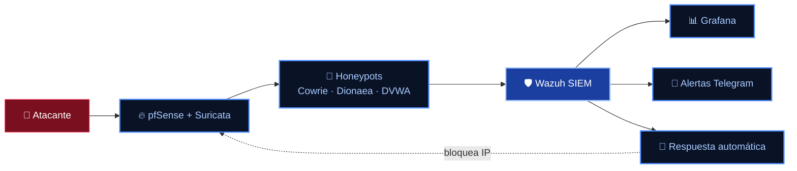

<!-- Paleta basada en la foto de perfil: negro azulado #050A18 · azul profundo #1B3FA0 · azul neón #4C8DFF · brillo #A9CCFF -->

### 🎓 Estudiante de CFGS Administración de Sistemas Informáticos en Red · 📍 Barcelona

---

## 👋 Sobre mí

Estudiante de **2º de ASIX** con experiencia real en **soporte IT (helpdesk)**: gestión de incidencias, administración de dispositivos, automatización con scripts y control de seguridad en equipos. Me interesan la **administración de sistemas**, las **redes** y la **ciberseguridad defensiva**. Aprendo de forma autónoma, documento lo que hago y me gusta trabajar en equipo.

| 🎯 Objetivo | 🔭 Ahora mismo | 🌱 En preparación |
|:---:|:---:|:---:|
| Técnico/a **junior de sistemas y redes**, con salida hacia **ciberseguridad** | Mi TFG **HoneyNet** (honeypots + SIEM) | **CCNA**, **Linux+**, Proxmox, Docker, pfSense, Wazuh |

---

## 💻 Stack tecnológico

**🔄 En aprendizaje**

### 🌐 Redes y servicios

| 🔧 Área | 📚 Conocimientos |
|---------|------------------|
| **Protocolos y servicios** | TCP/IP, UDP, HTTP/HTTPS, FTP, SSH, **DNS (Bind9)**, **DHCP** |
| **Direccionamiento** | IPv4, IPv6, subnetting, VLSM |
| **Routing** | Rutas estáticas, RIP, OSPF, NAT/PAT |
| **Switching** | VLANs, 802.1Q, trunking, STP, VTP |
| **Seguridad** | ACLs, Port Security, VPN, firewall básico |
| **Copias de seguridad** | rsync, tar.gz, SSH con claves, crontab |

---

## 🛠️ Competencias técnicas

| 🖥️ Sistemas operativos | 🌐 Redes | 🛡️ Ciberseguridad | 🗄️ Bases de datos |
|:---:|:---:|:---:|:---:|
| Linux y Windows, servicios, usuarios, permisos y scripts | VLANs, OSPF, NAT, ACLs y servicios de red | Honeypots, SIEM, segmentación y respuesta automática | Diseño relacional, SQL, procedimientos y triggers |
| [APUNTES-ASIX](https://github.com/alexnaranjooo/APUNTES-ASIX) | [Serveis-de-Xarxa-i-Internet](https://github.com/alexnaranjooo/Serveis-de-Xarxa-i-Internet) | [PROYECTO-HONEYNET](https://github.com/alexnaranjooo/PROYECTO-HONEYNET) | [Base_De_Datos](https://github.com/alexnaranjooo/Base_De_Datos) |

---

## 🚀 Proyectos destacados

### 🍯 HoneyNet — TFG de ciberseguridad *(en desarrollo)*

Infraestructura empresarial simulada que atrae, detecta y analiza intrusiones reales, y responde de forma automática.

**Tecnologías:** `Proxmox` · `pfSense` · `VLANs` · `Docker` · `Cowrie` · `Dionaea` · `DVWA` · `Wazuh` · `Grafana` · `Python`

### 🌐 Empresa AlwaysOn — Proyecto de redes

Red completa de una empresa ficticia: segmentación por departamentos con **VLANs**, routing dinámico con **OSPF** y seguridad con **ACLs**, **Port Security** y **NAT**. Simulada con `GNS3` y `Cisco Packet Tracer`.

### 📌 Repositorios

---

## 📊 Estadísticas

---

### 🤝 ¿Hablamos de sistemas, redes o ciberseguridad?

